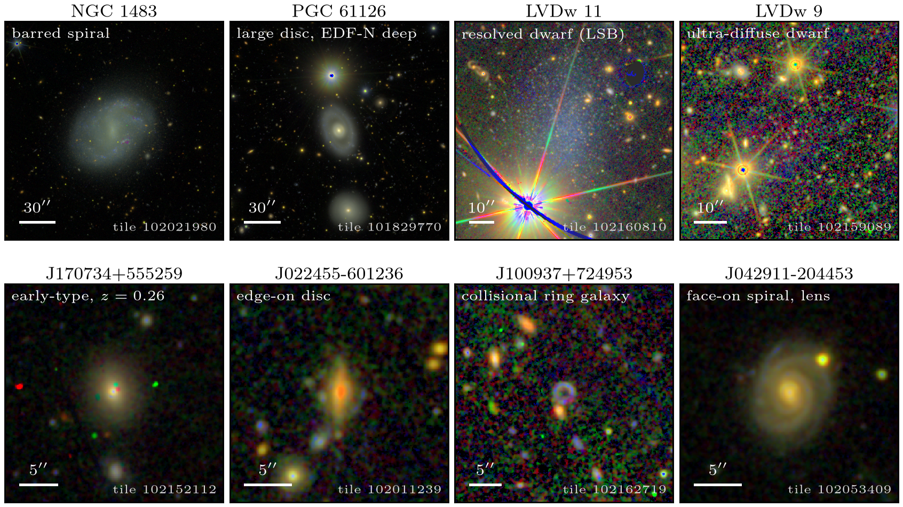

# euclid_fun

A working knowledge base, tested code and a quick guide for using **Euclid Data Release 1 (DR1-Foundation, public
2026-11-12)** for extragalactic science: photometry and 2-D modelling of extended, low-to-intermediate-redshift
galaxies, including low-surface-brightness (LSB) and intracluster-light (ICL) work.

Everything here was checked against the live ESA archive on release day. Where the documentation and the archive
disagree, the hands-on result wins and the discrepancy is recorded in
[kb/11_known_issues.md](kb/11_known_issues.md).



## What is here

| Part | Contents |
|---|---|
| [kb/](kb/00_index.md) | Knowledge base: 14 topical notes (data model, access, processing, PSF, catalogues, photo-z, spectra, masks, LSB, known issues, HATS/LSDB), one structured summary per DR1 paper, DPDD notes and a dump of the archive's TAP schema. Start at [kb/00_index.md](kb/00_index.md). |
| [demo/](demo/README.md) | Runnable end-to-end examples (`01`-`09`) built on a small helper library, `demo/dr1_access.py`. |
| [figures/](figures/) | Figures and measured numbers (JSON) produced by the demo. |
| `guide/src/` | Sources of a multi-page HTML quick guide; build it with `scripts/build_guide.py`. |
| [scripts/](scripts/) | Archive fetching, text extraction, TAP schema dump, full-text search, guide builder, shared plot style. |
| [docs/](docs/) | [SPEC](docs/SPEC.md) (architecture), [todo](docs/todo.md) (tasks), [lessons](docs/lessons.md) (mistakes and their fixes). |

## Selected findings

- **Over-deblending:** a ~2' galaxy (NGC 1483) is split into 6 large MER entries plus ~500 spurious entries, and no
  catalogue column isolates them cleanly ([kb/06 §10.1](kb/06_catalogues_photometry_morphology.md)).
- **LSB light is partly removed:** the MER background model takes out ~40-65% of the I_E light at a semi-major axis of
  ~100" around NGC 1483. Add the background model back before doing LSB work
  ([kb/10](kb/10_low_surface_brightness.md)).
- **Depth:** 3-sigma limits in 10"x10" boxes are I_E 28.2 (wide) / 29.0 (deep) mag/arcsec^2. Extrapolating the
  per-pixel RMS is 1.5-2.8 mag too optimistic.
- **Partial reads:** the ESA data service supports HTTP range requests. A 1' region of every calibrated VIS+Y+J+H
  exposure of a galaxy is ~0.9 GB instead of 39 GB of whole files (`demo/09_frame_cutouts.py`).
- **Footprint:** DR1 has no survey-wide footprint file. MOCs built from the tile polygons give 2235 deg^2 (wide) and
  87 deg^2 (deep).
- **IRSA HATS copy:** IRSA's HATS copy of the MER catalogue is identical to the ESA table, and it can be cross-matched
  with Gaia, Legacy Surveys DR10/DR11, DESI, HSC and WISE through LSDB ([kb/14](kb/14_hats_lsdb_access.md)).

## Quick start

Requires [uv](https://docs.astral.sh/uv/) and Python 3.12. The figures use LaTeX fonts, so a TeX installation is
needed for the demo plots.

```bash
git clone git@github.com:dr-guangtou/euclid_fun.git
cd euclid_fun
uv sync
```

`astroquery` is pinned to its GitHub `main` branch because the PyPI release (0.4.11) cannot yet make DR1 cutouts.

The demo uses anonymous archive access, so no account is needed. If code ever needs ESA Cosmos credentials, read them
from the environment (`EUCLID_USER`, `EUCLID_PASS`) and never commit them.

```bash
uv run python demo/01_get_cutouts.py          # cutouts of 8 galaxies from the DR1 papers
uv run python demo/09_frame_cutouts.py --dry-run   # which calibrated-frame units cover a target, without downloading
uv run python scripts/build_guide.py          # writes guide/site/index.html and a single-file version
uv run python scripts/kb_search.py build      # builds the full-text search index
uv run python scripts/kb_search.py "background model" --limit 10
```

See [demo/README.md](demo/README.md) for all steps, expected run times and results.

## Data and storage

Data never go into this repository:

- **Downloads:** go to `~/data/euclid/dr1_demo/`. The full demo uses ~12 GB, mostly two full tiles for the LSB step.
- **Archived source documents:** papers, the Explanatory Supplement, the DPDD and help pages, with their extracted
  text, are kept locally in `~/Desktop/euclid/`. `scripts/fetch_sources.sh` and `scripts/extract_text.py` rebuild that
  archive. Without it, the search index covers only the knowledge-base notes.
- **Generated outputs:** the built guide (`guide/site/`, `guide/euclid_dr1_quick_guide.html`) and the search index
  (`kb/kb_index.sqlite`) are not tracked.

## Development

- Python through `uv` only (`uv run ...`, `uv add ...`); `snake_case` names; English only.
- Lint and format with Ruff (`uv run ruff check`, `uv run ruff format`); the pre-commit hook runs both.
  Run `uv run pre-commit install` once after cloning.
- Work on feature branches and merge into `main` through pull requests.
- Figures are publication quality with LaTeX fonts, using `scripts/plot_style.py`.
- `docs/SPEC.md` is the architecture source of truth; record mistakes and their fixes in `docs/lessons.md`.

## Credits and licence

Euclid DR1 data are provided by ESA and the Euclid Consortium under
[CC BY-NC 3.0 IGO](https://www.cosmos.esa.int/web/euclid/dr1-data). If you use the data, cite the DR1 papers; the
knowledge base lists them in [kb/papers/](kb/papers/). The notes in this repository are summaries written for this
project and are not official ESA or Euclid Consortium documents.

A licence for this repository's code and notes has not been chosen yet.
